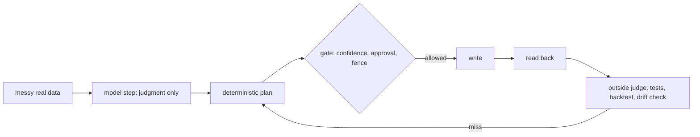

## Ganesh Kumar

I build agent systems and the judges that keep them honest.

By trade I'm a product leader. On my own time I write the code, the evals and the guardrails for the 30+ scheduled Claude agents that run my work week, then rebuild the useful parts here with synthetic data. Every repo runs from a clean clone with plain `python3`, has CI on Python 3.9 and 3.12, and says where it fails.

That loop is the pattern behind most of what is below: the model does the one step that needs judgment, code does everything that can be checked, and nothing counts as done until something other than the model says so.

### Selected work

| Repo | What it does | The outside judge | CI |
|---|---|---|---|
| [meeting-crosswalk](https://github.com/gkmr/meeting-crosswalk) | Reconciles two meeting recorders and the calendar: infers titles from content, files every capture, writes back with read-back verification | Backtest on a real 1,152-meeting library and a monthly drift check |  |
| [vc-diligence-harness](https://github.com/gkmr/vc-diligence-harness) | Data-room diligence as a Claude skill plus checkers: evidence per document, contradictions first, four gates, staged recommendation | Planted-contradiction tests and mutation tests on the synthesis |  |
| [shortcut-keeper](https://github.com/gkmr/shortcut-keeper) | macOS shortcuts as infrastructure: desired state, an independent scanner of each app's real config, policies, safe auto-repair | Injected-drift end-to-end test; repairs wait while a call is live |  |
| [krisp-live-copilot](https://github.com/gkmr/krisp-live-copilot) | Unofficial live meeting copilot: reads the call as it happens and answers "what did I miss" without copy-paste | File-mode tests; latency measured on real calls |  |
| [ganesh-os](https://github.com/gkmr/ganesh-os) | The governance layer for the agent fleet: single-writer field ownership, lane fences, catch-up for missed runs, human gates | Lane-fence evals and wrapper behavior tests |  |

### Evals and failure analysis

- **Backtest on real data.** meeting-crosswalk's planner ran against my own 1,152-meeting library: mislabeled titles went from 74% to 9%, meetings outside a single folder from 101 to 19, with 1,689 tag removals and 141 additions and zero failed writes. Two outside judges checked it: folder parity against the second recorder (37 of 40 agree, the 3 misses are time collisions), and an independent re-read that caught one misfile the planner made. [Details](https://github.com/gkmr/meeting-crosswalk/blob/main/docs/backtest.md).
- **Tests that prove the negative.** vc-diligence-harness has to find exactly the 3 contradictions planted in a synthetic data room and ignore two near-misses inside tolerance. Its synthesis checker has to reject every one of 11 deliberately broken syntheses.
- **Calibration, stated honestly.** career-agent-kit's altitude test agrees with my hand labels on 36 of 40 sentences, and that is enforced as a regression floor, not claimed as accuracy. 20 of its 30 evals are graded by script; the other 10 are listed as needing a model or a person.
- **Measured, including where it breaks.** krisp-live-copilot sees words 2 to 3 seconds after they are spoken. The faster live-file path worked in 11 of 14 recordings, and the README says what happens in the other 3.

### How I work

- **Bug reports become failing tests first.** An outside user filed three bugs against ganesh-os's run wrapper ([#8](https://github.com/gkmr/ganesh-os/issues/8), [#9](https://github.com/gkmr/ganesh-os/issues/9), [#10](https://github.com/gkmr/ganesh-os/issues/10)). The fix shipped the same day with 7 behavior tests, all of which fail on the old code.
- **Every write is read back.** A write that was not verified did not happen, and low-confidence results are never written.
- **Instructions inside data are data.** Emails, transcripts and web pages never steer an agent.
- **Stdlib only, CI weekly.** No dependencies to rot, and a scheduled run catches a broken runner even when nothing changed.
- **No personal data.** Everything here is synthetic or aggregate, and each repo passes a leak scan before it ships.

### Method kits and small tools

| Repo | What it is | CI |
|---|---|---|
| [drafting-harness](https://github.com/gkmr/drafting-harness) | A drafting method (fork by opposed objectives, test against a named adversary, select one, never merge) with a linter that fails tone-only forks |  |
| [career-agent-kit](https://github.com/gkmr/career-agent-kit) | Claude skills for a senior job search, with an altitude counter and a claim checker as judges |  |
| [mac-mcp-patches](https://github.com/gkmr/mac-mcp-patches) | Fixes for timeouts in the iMessage and Apple Notes MCP servers, as unified diffs with safe apply, check and revert |  |
| [linkedin-network-map](https://github.com/gkmr/linkedin-network-map) | A local index of warm paths into target companies, built from a connections export |  |

This page checks itself: a weekly job confirms every repo linked here exists and its latest CI run is green. [profile-check](https://github.com/gkmr/gkmr/actions/workflows/profile-check.yml)
